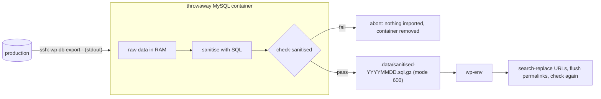

# Local environment

A local WordPress (wp-env, Docker) that matches production closely, loaded with a **sanitised** copy of the real content.

## Setup

Requirements: Docker running, Node 22 (`.nvmrc`), `npm ci`, and SSH access to `triton.devnel.com` (only needed to pull data; everything on production is read-only).

```sh
npm run env:start        # http://localhost:8888 (tests site on :8889); admin / password
npm run env:sync         # optional: pin core and plugins to production's versions (see below)
npm run db:pull          # sanitised production content into wp-env
npm run uploads:pull     # optional: production's wp-content/uploads into .data/uploads
npm run env:stop         # stop (data is kept)
npm run env:reset        # wipe wp-env's databases back to a fresh install
```

After `db:pull` the local admin is `admin` / `password` (a local-only account, created or reset by the pull). Every other user has a random password hash: nobody can log in as a real user.

## Versions: what `.wp-env.json` pins and what `env:sync` pins

- `.wp-env.json` (committed) pins PHP 8.4, a WordPress **release** and wordpress.org plugin zips that CI can download. These are not necessarily production's versions: this repository is public and must not record exactly what production runs.
- `npm run env:sync` reads production's core and plugin versions **read-only** (`wp core version`, `wp plugin list --fields=name,version,status --format=json`) and writes `.wp-env.override.json`, which is gitignored. wp-env merges it over `.wp-env.json`, so locally you run exactly what production runs. Apply it with `npm run env:start -- --update`.
- Left out of the override, with a note when you run it: plugins that must not run locally (`worker`, `post-smtp`, `updraftplus`, `nginx-cache`, `redis-cache`, `amazon-s3-and-cloudfront`) and plugins with no wordpress.org release zip (`friends-autoresolve-links`, `friends-post-collection`; the blocks they register show as unregistered locally).
- To bump the committed set, edit the versions in `.wp-env.json`.

## How `db:pull` keeps raw data off your disk



1. `ssh triton.devnel.com 'cd ~/devnel.blog/public && wp db export - --single-transaction'` streams the export to stdout. Nothing is written on the server.
2. It goes straight into a **throwaway MySQL 8.4 container**: `--network none` (no network at all), no published ports, a random name, data on a `tmpfs` (memory, not disk). The only way in is `docker exec`, and the root account has no password because nothing can reach it.
3. The sanitising SQL runs there, then `scripts/check-sanitised.sh` must pass against the container. If it fails, the script stops with nothing imported anywhere.
4. Only the sanitised database is exported, to `.data/sanitised-YYYYMMDD.sql.gz`, and the container is removed (a trap removes it on every exit path, including errors and Ctrl-C).
5. That file is imported into wp-env, then `wp search-replace https://devnel.blog http://localhost:8888 --all-tables --precise` (URLs only), a permalink flush, the local admin, deactivation of production-only plugins, and `check-sanitised.sh` again against wp-env.

No raw dump file is ever written, and raw data never enters wp-env. If a step before 5 fails, wp-env is untouched. (If the import in 5 itself fails halfway, re-run `db:pull`.)

Files: `.data/` is mode 700 and snapshots are mode 600 (the scripts set `umask 077`). The last 3 snapshots are kept, older ones are deleted. The scripts refuse to run if `.data` is inside the repository and git would not ignore it.

The first run pulls the `mysql:8.4` image from Docker Hub.

### What is sanitised

The list lives once, in `scripts/sanitise/*.txt`, and is used by both the sanitiser and the check.

| Where | What happens |
| --- | --- |
| `wp_users` | `user_email` becomes `userN@example.test`; `user_pass` is a random hash; `user_activation_key` is emptied; `user_url`, login and display name stay (they are public) |
| `wp_usermeta` | `session_tokens`, the magic-sig keys, `_application_passwords`, the Jetpack password hashes and any key matching `%private%`, `%token%` or `%secret%` are deleted; any value holding an email address, or a PEM block, is anonymised or deleted |
| `wp_comments` | `comment_author_email` becomes `commenterN@example.test`; `comment_author_IP` becomes `127.0.0.1`; `comment_agent` is emptied |
| `wp_commentmeta` | rows holding an email or an IP are deleted |
| Emptied tables | Post SMTP logs, Redirection 404s and logs, the Jetpack WAF log, and every `wp_zbs_*` (Jetpack CRM) table. `wp_redirection_items` and `wp_redirection_groups` stay |
| `wp_options` | secrets and keys are deleted (ActivityPub key pairs, ManageWP, Friends keys, mail-by-post and Post SMTP credentials, API keys, UpdraftPlus remote storage, S3 offload, Freemius, Jetpack private options, salts and keys stored in the DB, recovery keys, transients); `admin_email` becomes `admin@example.test`; any option holding a PEM block is deleted |
| Plugins | `worker`, `post-smtp`, `updraftplus`, `nginx-cache` and `redis-cache` are deactivated in wp-env |

`scripts/check-sanitised.sh` (also `npm run db:check`, against wp-env) fails, printing table and column names but never the values, if it finds any of:

- an email-shaped string that is not an `@example.test` address, in any text column of any table;
- an IPv4 or IPv6 address in the comments tables (other than `127.0.0.1`);
- a `-----BEGIN` PEM block in any text column;
- an option or usermeta key from the lists above;
- a row in a table that should be empty.

Because it is strict, a post that quotes an email address or an IP will make the check fail and name the column. That is deliberate: look at that content before relaxing the check.

Sanitised does not mean anonymous: post and page content, comment text, names, comment author URLs, usernames and the structure of the site are the real thing. Treat `.data/` as private anyway.

## What wp-env exposes

wp-env 11 publishes (via Docker Compose) these ports on **all interfaces** (`0.0.0.0`), not only localhost:

| What | Port |
| --- | --- |
| Development site | 8888 |
| Tests site | 8889 |
| MySQL (development and tests) | a random high port each, printed by `env:start` (root / `password`) |

wp-env has no setting to bind these to `127.0.0.1` or to turn the MySQL port off (`mysqlPort` only chooses the number, and the port environment variables must be plain numbers). So anything on your network can reach the local site and its database while wp-env runs. This is acceptable only because **only sanitised data ever reaches wp-env** (see above): there is no PII or secret in it to leak. Use a trusted network or your OS firewall if you care about someone tampering with the local copy.

The throwaway sanitising container, which does hold raw data for a short time, publishes nothing and has no network.

## Uploads

`npm run uploads:pull` runs `rsync -a --delete` from production's `wp-content/uploads` into `.data/uploads`, which wp-env maps to `wp-content/uploads`. Production is only ever the rsync source (never `--remove-source-files`); `--delete` only removes files from your local copy.

Images in uploads are public on the live site, so they are not sanitised.

## Troubleshooting

- `wp-env is not running`: `npm run env:start`.
- `docker is not running`: start Docker (or OrbStack).
- `not gitignored`: `.data/` must stay in `.gitignore`.
- The check failed: the output names tables and columns. Fix the cause in `scripts/sanitise/` (and add a test), don't weaken the check.
- Production moved to new versions: `npm run env:sync` then `npm run env:start -- --update`.
