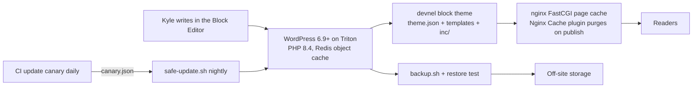
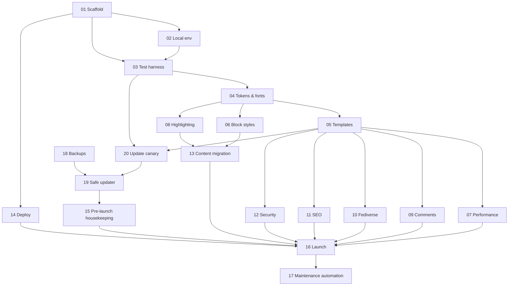

# Plan

## Goal

Give devnel.blog a simple, focused design that matches the devNel brand, without leaving WordPress or the Block Editor, and make the server reliable to run: backups that actually restore, and core and plugins that stay current without breaking the site.

## Architecture

- **Theme:** a custom block theme built from scratch in `theme/devnel/`. Design comes from `theme.json`; a little PHP in `inc/` covers performance, SEO, code highlighting and security. No build step: plain CSS, and Composer only for the highlighting library and dev tools.
- **Caching:** already handled by the server. nginx caches whole pages, and the Nginx Cache plugin purges on publish. No paid CDN or APO (see DECISIONS.md).
- **Content:** stays in WordPress. A one-off migration (issue 13) cleans up dead blocks from old plugins.
- **Operations:** backups (18), a safe auto-updater with smoke checks and rollback (19), and a CI canary that tests new major versions before production gets them (20).

## Design direction

The devnel.com brand, simplified for reading:

- **Keep:** the palette and the dark remap (pine background, cream text, sun accents), Source Sans 3 for body text, Quando for post and page titles only, IBM Plex Mono for dates, tags, labels and code, the `[>·<]` bowtie mark, mono `<angle brackets>` as an occasional eyebrow.
- **Drop:** the `// \\` slash pattern (a thin strip in the footer at most), scroll reveals, the highlighter animation, case-study layouts.
- **Layout:** one column (`contentSize` 68ch); wide images can break out to `wideSize`. Header: mark + "devNel blog" wordmark + a short nav. Footer: link to devnel.com, RSS, Fediverse handle.
- **Pages:** home (post list: mono date, Quando title, one-line excerpt), single post, page, archive (category/tag/date/author), search, 404 (bowtie).

## Waves and dependencies

- **Wave 0 (foundation):** 01, 02, 03.
- **Wave 1 (theme core):** 04, then 05, 06, 08 in parallel, then 07, 09, 10.
- **Wave 2 (cross-cutting):** 11, 12, 13.
- **Wave R (server reliability):** 18 can start **right away**, independent of everything else. 19 needs 18; its majors gate needs 20 (19 can ship with majors held until 20 lands).
- **Wave 3 (ship):** 14 any time after 01; 15, 16, 17 in order.

Issue 18 fixes a real risk on production today (backups that don't restore, disk filling up). It should be the first thing worked on, alongside 01.

## Out of scope

- A headless/Astro frontend (considered and rejected; see DECISIONS.md).
- Changing permalinks or the domain.
- Moving hosts.
- The other sites on Triton (listed in devnel-ops). Scripts in 18 and 19 are config-driven so they can be added later.
