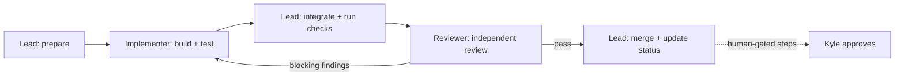

# Workflow: lead, implementer, reviewer

Every issue goes through three roles. They're separate agents so that the reviewer comes to the work with no stake in it.

## Team lead (main session, Opus)

1. **Pick** the next issue from `issues/README.md` whose dependencies are all `done`. Set it to `in progress`.
2. **Prepare:** create a worktree and branch `issue/NN-slug` from `main`. Re-read the issue, `CLAUDE.md`, the relevant parts of `docs/QUALITY.md`, and `docs/SERVER.md` if it touches production. If the issue is ambiguous, settle it now (ask Kyle if needed) and write the answer into the issue.
3. **Brief the implementer** (Agent tool, `subagent_type: implementer`, `model` as named in the issue, `isolation: worktree`). Include the issue path, the branch, and anything decided in step 2. Don't paste the whole conversation; the issue file has to be enough on its own.
4. **Integrate:** read the implementer's report and the diff. Run `npm run check` yourself. Fix small integration problems; anything bigger goes back to the implementer.
5. **Review:** start the reviewer (`subagent_type: reviewer`, model in the issue, normally Opus) with **only** the issue path, the branch and the base commit. Never the implementer's reasoning.
6. **Loop:** blocking and should-fix findings go back to the implementer (or get fixed by the lead if trivial), and then a **new** reviewer runs. Nits are optional. Stop after three rounds and escalate to Kyle.
7. **Merge:** squash-merge to `main` with a message referencing `#NN`. Update `issues/README.md` status, tick the acceptance criteria in the issue file, and note any follow-ups.
8. **Human-gated steps:** list the exact commands for Kyle, wait for an explicit yes, run them, record the outcome in the issue (date, output summary).

## Implementer

- Model per issue: **Sonnet** by default. **Opus** when the issue sets an architecture other issues build on (04), mutates production data (13), is security-critical (12), or automates production with rollback (19). **Haiku** only for mechanical checklists (15).
- Works only within the issue's scope, on its branch.
- Writes the tests the issue lists **as well as** the code. Runs `npm run check` (or the subset the issue names) before reporting.
- Reports: what changed (files), what was tested and how, anything not done, anything uncertain. No claims without having run the command.

## Reviewer

- **Opus**, fresh context, read-only (it can run tests and linters; it can't edit).
- Inputs: the issue file, `docs/QUALITY.md`, `CLAUDE.md`, and `git diff <base>...<branch>`.
- Checks in order:
  1. Each acceptance criterion, with evidence (a file, a line, a test name, command output).
  2. The issue's **Review focus** list.
  3. The six quality areas in QUALITY.md that apply.
  4. Guardrails in CLAUDE.md (production writes, secrets, third-party requests).
  5. Tests actually test the behaviour (they would fail without the change).
- Output: findings ranked **blocking / should-fix / nit**, each with file:line and a concrete failure scenario, and a final verdict of **pass** or **changes needed**. No speculative style opinions.

## Definition of done

- [ ] All acceptance criteria met and ticked in the issue file
- [ ] Required tests added; `npm run check` green locally and in CI
- [ ] Reviewer verdict: pass (no blocking findings)
- [ ] Docs updated where behaviour or commands changed (README, CLAUDE.md, MAINTENANCE.md, CHANGELOG)
- [ ] Human-gated steps either done and recorded, or listed as pending in `issues/README.md`

## Branches, commits, CI

- `main` is always deployable. One branch per issue. No direct pushes to `main` once CI exists.
- CI (issue 01) runs on every PR: lint, phpcs, phpstan, stylelint, PHPUnit, Playwright + axe, contrast, Bats, `composer audit`, `npm audit --omit=dev`.
- If the repo isn't on GitHub yet, the lead runs `npm run check` locally as the gate and notes that in the merge commit.
